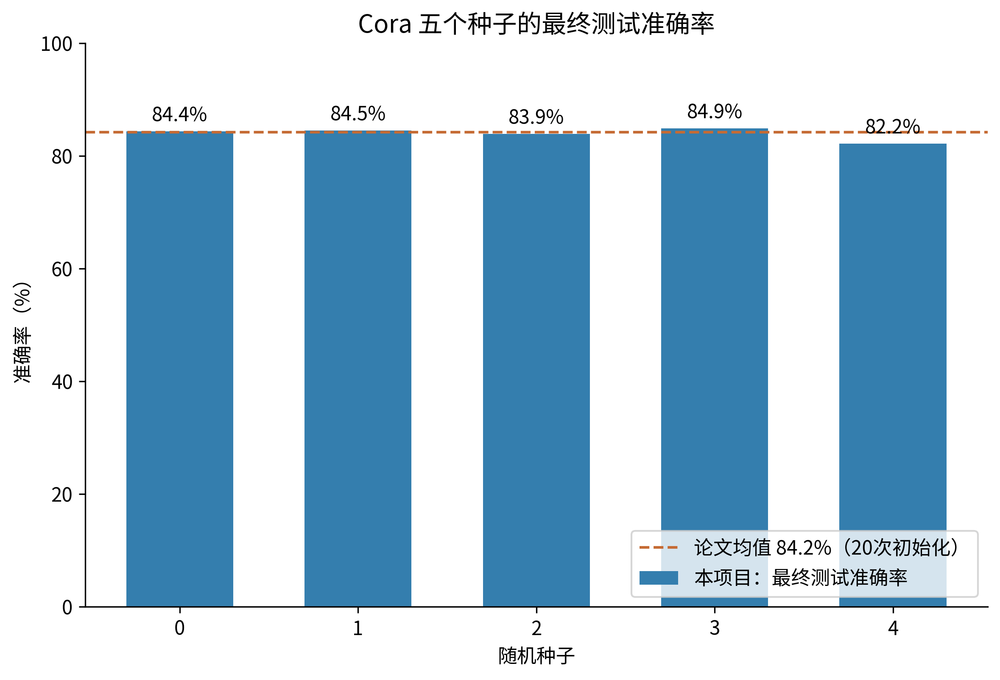
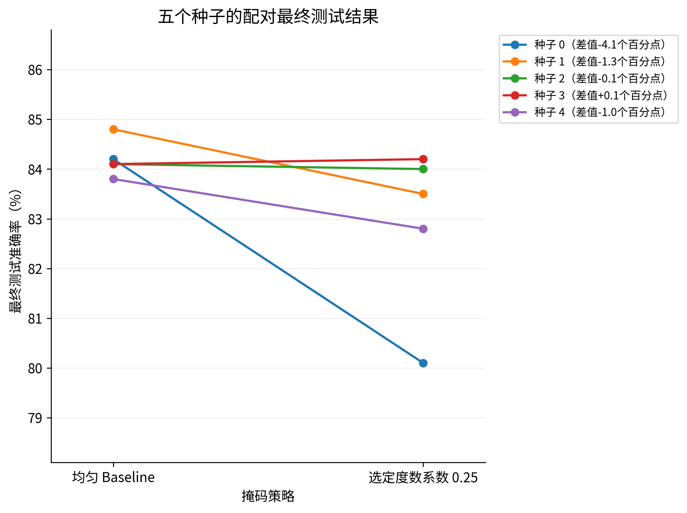

# GraphMAE：论文精读、原始复现与度数感知掩码实验

研究生机器学习课程项目，基于 **GraphMAE（KDD 2022）官方PyG实现**，完成论文精读、Cora五种子复现及Degree-aware Masking自主对照实验。本项目属于课程级部分复现，不宣称完整复现或科研新颖性。

## 阅读导航

| 内容 | 入口 |
|---|---|
| 论文精读与数学公式 | [精读笔记](docs/paper/PAPER_NOTES.md)、[算法原理章节](reports/sections/03_method.tex) |
| 官方代码与环境审计 | [SOURCE_AUDIT](docs/SOURCE_AUDIT.md)、[ENVIRONMENT_AUDIT](docs/ENVIRONMENT_AUDIT.md) |
| 原始算法复现 | [M1验收](M1_ACCEPTANCE.md)、[五种子统计](results/processed/M1/summary.csv)、[对照分析](results/processed/M1/comparison.md) |
| 度数掩码方法 | [采样适配源码](scripts/m2_masking.py)、[方法章节](reports/sections/06_degree_masking.tex) |
| 自主实验与负结果 | [M2验收](M2_ACCEPTANCE.md)、[比较分析](results/processed/M2/M2_COMPARISON.md)、[配对结果](results/processed/M2/paired_comparison.csv) |
| 中文报告与附录 | [LaTeX主文件](reports/main.tex)、[Windows编译说明](BUILD_ON_WINDOWS.md) |
| 真实主要Codex记录 | [五阶段记录索引](agent_logs/MAIN_RECORDS.json) |
| 实验规范 | [Skill](SKILL.md)、[Agent工作流](AGENT_WORKFLOW.md) |
| 完整电子附件 | [GitHub Release](https://github.com/ZywOo112/graphmae-course-reproduction/releases/tag/course-m3.3)，含数据、必要checkpoint及Git bundle |

## 真实实验结论

| 实验 | 测试Accuracy均值 | 样本标准差（百分点） |
|---|---:|---:|
| M1：官方均匀掩码，5 seeds | 83.98% | 1.056882 |
| M2：同协议均匀控制组，5 seeds | 84.20% | 0.367423 |
| M2：验证选定degree_alpha=0.25，5 seeds | 82.92% | 1.666433 |

原论文Cora参考值为84.2%±0.4%，采用20次初始化。M2仅用验证集在0.25、0.5、1.0中选择正向系数0.25；**五种子平均配对变化为−1.28个百分点，未取得提升**。0.5和1.0没有最终测试。M1/M2实际选点随机流不同，算法对照仅在M2内部成立；最后一次M2测试从L40迁至A40的限制也完整披露。





## 下载与复现

本Git仓库包含代码、官方源码快照及MIT许可证、精读、完整训练/Probe文本记录、保存预测、汇总、图表和LaTeX。为避免将训练权重和数据缓存写入Git历史，Cora数据、`.pt/.pth`和Git bundle放在[完整Release附件](https://github.com/ZywOo112/graphmae-course-reproduction/releases/tag/course-m3.3)中，未删除任何历史实验文件。仓库内附录仍可直接从`reports/`编译；实际模型重跑应下载完整附件并按固定依赖重建Linux/CUDA环境。

完整ZIP：`GraphMAE_M3_3_20261116T154053Z.zip`，约242.7 MiB；SHA256：`e6661d73bb48b2f6b2f6d6b7b74f0581f5669bff34c08c179d59386906558839`。Release同时提供校验文件。**服务器未编译最终PDF**；请按Windows说明在本地使用XeLaTeX编译。

官方PyG Commit：`9127f25e01aa5ba1cca68b746284aeb7ab2b4850`。下方保留课程项目原始运行说明和历史阶段记录；早期精读中的待实现设想以M2实际实验为准。

---

# GraphMAE 机器学习课程大作业

课程级部分复现与Degree-aware Masking自主实验。当前 **M3.3附录与电子交付整理已完成，暂停等待本地编译及用户验收**。本次度数方案未提升分类性能；未运行Citeseer。正文、完整附录和真实五阶段对话已具备，尚未生成最终PDF。

## 最终交付入口（M3.3）

- LaTeX工程：[reports/main.tex](reports/main.tex)，九章正文及附录A—D已接入，所有依赖为相对路径。
- Windows本地编译：[BUILD_ON_WINDOWS.md](BUILD_ON_WINDOWS.md)。完整解压交付ZIP后，从reports目录用XeLaTeX/BibTeX或latexmk编译；只编译报告无需Python、CUDA或重新运行实验。
- 交付ZIP位于`deliverables/GraphMAE_M3_3_*.zip`，准确文件名、字节数和SHA256见[reports/M3_3_DELIVERY.json](reports/M3_3_DELIVERY.json)；同名`.zip.sha256`提供下载校验。外部收据在服务器交付入口保留，ZIP内部有FILE_MANIFEST.json和SHA256SUMS.txt完整校验索引。
- 验收：[reports/M3_3_ACCEPTANCE.md](reports/M3_3_ACCEPTANCE.md)；附录清单：[docs/APPENDIX_MANIFEST.md](docs/APPENDIX_MANIFEST.md)；全阶段实际记录索引：[agent_logs/MAIN_RECORDS.json](agent_logs/MAIN_RECORDS.json)。旧docs/PROJECT_FILES.txt是历史清单，最终完整文件清单以ZIP内索引为准。
- ZIP包含完整自编代码、两份官方源码与MIT LICENSE、Git bundle、Cora及全部M0/M1/M2结果/预测/必要权重；不含venv、pycache、机器专属.git指针、字体二进制或commentary导出。服务器原有字体与历史文件没有删除。PDF编译使用TeX Live自带Fandol，已渲染实验图无需绘图字体。
- M0、M1、M2、M3.1、M3.2五个主要Prompt与真实最终回答已逐字提取；M3.3最终回答尚未产生，不预写。误发的其他项目任务及过程消息不进入本项目对话附件。

以下保留各阶段运行说明和历史状态，当前阶段以上述交付入口及PROGRESS.md为准。不要为编译报告重新运行历史初始化、训练或M0归档检查器；本次没有运行模型或TeX编译。

论文：[GraphMAE，KDD2022](https://arxiv.org/abs/2205.10803v3)。正式实现：[THUDM/GraphMAE PyG](https://github.com/THUDM/GraphMAE/tree/9127f25e01aa5ba1cca68b746284aeb7ab2b4850)，Commit `9127f25e01aa5ba1cca68b746284aeb7ab2b4850`。第三方原始文件未修改。

## 材料入口

- [PROJECT_PLAN.md](PROJECT_PLAN.md)：M0–M3计划及正式实验协议。
- [PROGRESS.md](PROGRESS.md)、[DECISIONS.md](DECISIONS.md)：进展、问题和决策。
- [源码审计](docs/SOURCE_AUDIT.md)、[环境审计](docs/ENVIRONMENT_AUDIT.md)、[论文笔记](docs/paper/PAPER_NOTES.md)。
- [附录清单](docs/APPENDIX_MANIFEST.md)：代码、真实Agent记录、规范和第三方附件管理。
- [完整项目文件清单](docs/PROJECT_FILES.txt)：排除可重建venv后的实际文件列表；第三方逐文件清单另见审计日志。
- [SKILL.md](SKILL.md)、[AGENT_WORKFLOW.md](AGENT_WORKFLOW.md)：项目专属操作与复核流程。

## 已有环境与短测

在本项目根目录执行（目录名包含中文，shell中路径应加引号）：

```bash
.venv/bin/python -c 'import torch, torch_geometric; print(torch.__version__, torch.version.cuda, torch.cuda.is_available(), torch_geometric.__version__)'
nvidia-smi
.venv/bin/python scripts/smoke_test.py --gpu 1
```

先选空闲GPU。若共享，确认至少8GiB可用并显式加`--allow-shared`；不要终止其他项目进程。M0实际成功运行使用物理GPU0共享L40。短测读取configs/smoke.json，先装载官方配置再覆写20+20轮，调用官方模型、pretrain与线性评估，不跑1500轮。

成功数据：Cora2708×1433、7类、public split140/500/1000，loss0.9990→0.5295，validation-selected test Accuracy74.3%。仅为Smoke Test诊断，不能当作正式复现。详细输出在results/raw/M0/smoke_20261112T040413960326Z/，控制台见相邻validation目录。

## 在新目录重建环境

使用Python3.11和uv，运行`python3 scripts/setup_env.py`。它仅在没有`.venv`时创建环境，安装固定torch cu121与匹配PyG扩展，然后其他依赖。已有环境不重复运行该初始化器；`scripts/bootstrap_m0.py`是本次原始初始化源代码附件，也不能在现有目录直接重跑。

精确版本见configs/requirements.lock.txt。在新的venv中可按以下顺序安装锁定版本（不要对已有base环境运行）：

```bash
python3 -m venv .venv
uv pip install --python .venv/bin/python 'torch==2.4.1+cu121' --index-url https://download.pytorch.org/whl/cu121
uv pip install --python .venv/bin/python --no-deps --only-binary :all: 'torch-scatter==2.1.2+pt24cu121' 'torch-sparse==0.6.18+pt24cu121' --find-links https://data.pyg.org/whl/torch-2.4.0+cu121.html
uv pip install --python .venv/bin/python -r configs/requirements.lock.txt --extra-index-url https://download.pytorch.org/whl/cu121 --find-links https://data.pyg.org/whl/torch-2.4.0+cu121.html
uv pip check --python .venv/bin/python
```

Python/平台改变时不能机械复用CUDA扩展轮子；需重新审计，不能把安装成功当作GPU前向成功。

## 报告与附录

最终格式仅LaTeX。骨架为reports/main.tex、references.bib和appendices/；M0没有图片素材需求，figures目录供后续实验使用。使用ctexart、A4单栏、数字引用。附录正文9pt、对话8.5pt、代码7.5pt，用fvextra自动导入完整文件、自动换行和分页。

```bash
.venv/bin/python scripts/generate_appendices.py
.venv/bin/python scripts/build_report.py
```

构建器先更新附录；缺XeLaTeX/BibTeX时返回2并记录reports/build_status.json，不安装系统软件。当前服务器即此状态，无main.pdf。已配置TeX Live的机器可使用上面的构建器；也可从reports/运行`latexmk -xelatex -interaction=nonstopmode -halt-on-error main.tex`。不能只复制reports/，附录依赖项目相对路径。

## 真实Agent记录

M0已有真实记录完整保留。按M1最新要求，M3再统一整理各阶段主要真实任务Prompt和Codex最终回答；不编造，不用总结代替原文。本阶段不启动监听器，不要求commentary归档。

## 第三方与电子附件

third_party包含PyG正式工作树、DGL审计工作树和可离线恢复完整历史的GraphMAE.bundle；保留MIT LICENSE。worktree的`.git`指针可能随移动失效，但源码文件完整可运行；用bundle可恢复Git元数据。提交必须包含实际完整源码和数据，不能仅提供URL。venv不打印，可按锁文件重建；完全离线安装依赖时需另备wheelhouse。


## M1正式复现：已完成

原始批次：`results/raw/M1/cora/20261113T065001179740Z/`。每seed保存1500轮loss/LR、7次300轮周期Probe、最终300轮Probe、有效配置、数据与源码哈希、GPU信息、时间、预测、split及两个必要checkpoint。第三方源码不变，使用现有训练venv。

`--gpu 1`只出现在M0短测示例，表示物理nvidia-smi编号；M0实际成功用物理0。M1实际用物理2 A40，按UUID设置CUDA_VISIBLE_DEVICES，内部cuda:0，核验PID实际GPU，不能把逻辑0当物理0。

重新运行正式实验时先生成新批次（以下用实际输出路径替换示例变量），不要直接重跑已有结果目录：

```bash
.venv/bin/python scripts/preflight_m1.py
.venv/bin/python scripts/check_m1_protocol.py
M1_BATCH_PATH="/上一步输出的完整批次路径"
.venv/bin/python scripts/run_m1.py --batch "$M1_BATCH_PATH" --seeds 0
.venv/bin/python scripts/run_m1.py --batch "$M1_BATCH_PATH" --seeds 1 2 3 4
.venv/bin/python scripts/analyze_m1.py --batch "$M1_BATCH_PATH" --output results/processed/M1_新批次
/home/fuqiang/anaconda3/bin/python scripts/plot_m1.py --summary results/processed/M1_新批次/summary.json --output figures/M1_新批次
```

以上仅为复跑说明，M1已完成，不需再次执行。预检只做CPU审计和三次GPU采样，不训练；GPU不足8GiB或严重占用时拒绝启动。没有自动预占或终止他人进程。

运行器规范设置Python/NumPy/Torch CPU/CUDA种子及cuDNN deterministic=True、benchmark=False，不强制确定性GPU scatter。它直接调用官方pretrain，周期Probe时点、分类器初始化/更新及RNG不隔离；仅回调去掉测试计算。预训练图删除标签，Probe只接收train/val；encoder固定1500轮，final分类器完整300轮后按val>=规则选较晚平分轮，写盘后才测试一次。

结果：Accuracy与Micro-F1均为83.98%±1.05688个百分点，平均每seed26.09秒。论文84.2±0.4%采用20次初始化，本项目只有5种子且框架/GPU不同。seed4为82.2%，全部保留，没有调参、挑种子或重跑。详细表格与解释见[comparison.md](results/processed/M1/comparison.md)。

图表：figures/M1/loss_curves.png、loss_mean_std.png、accuracy_comparison.png、validation_results.png、runtime_comparison.png，均中文300dpi。均值波动带是逐轮跨5种子的样本标准差，不是置信区间。训练用项目venv，绘图复用base已有Matplotlib3.8.0，不重装依赖；Noto中文字体及LICENSE仅存项目assets。修正标题裁切时归档旧渲染，不改实验数据。

M1不要求服务器LaTeX编译，报告最终由用户本地统一编译。M1到此暂停；M2须另行授权。

## M2：度数感知掩码自主实验（已完成）

M2 Baseline=84.20%±0.37个百分点；选定degree_alpha=0.25为82.92%±1.67个百分点。配对差值均值-1.28个百分点，样本标准差1.68个百分点（全部ddof=1）。

四组验证均值分别为80.04%、79.60%、78.52%、76.16%；按正向系数的验证均值选择0.25，不使用测试结果选参。所有正向方案验证均值低于Baseline，仍按预定规则保留最佳正向方案。详见[M2比较分析](results/processed/M2/M2_COMPARISON.md)。

原始批次：`results/raw/M2/cora/20261114T070950207116Z/`，含degree/、pilot/、control/、degree_alpha_0.25/、degree_alpha_0.5/、degree_alpha_1/。每组5种子均完整1500轮预训练、7次300轮周期Probe及最终300轮Probe。系数0.5和1.0没有测试结果；result.json只含训练/验证，允许评价的模型另有final_test.json和test_predictions.npz。

四组使用独立CPU Generator(seed)实际选点：Baseline均匀randperm，正向multinomial无放回；共同保留原CUDA randperm消耗。完整逐轮全局RNG和替换轨迹一致；这是相对M1的明确RNG协议调整，因此M2控制重新训练，不直接复用M1的83.98%。

分阶段复跑说明（已完成，无需再次执行；必须使用新批次）：

```bash
.venv/bin/python scripts/run_m2.py --stage prepare
M2_BATCH_PATH="/上一步输出的新批次路径"
.venv/bin/python scripts/check_m2.py --batch "$M2_BATCH_PATH"
.venv/bin/python scripts/run_m2.py --stage pilot --batch "$M2_BATCH_PATH"
.venv/bin/python scripts/run_m2.py --stage train --batch "$M2_BATCH_PATH"
.venv/bin/python scripts/run_m2.py --stage select --batch "$M2_BATCH_PATH"
.venv/bin/python scripts/run_m2.py --stage test --batch "$M2_BATCH_PATH"
.venv/bin/python scripts/analyze_m2.py --batch "$M2_BATCH_PATH" --output results/processed/M2_新批次
/home/fuqiang/anaconda3/bin/python scripts/plot_m2.py --summary results/processed/M2_新批次/summary.json --output figures/M2_新批次
```

全部20次训练和前9次测试用GPU0 L40。最后0.25/seed4在资源检查中停止，尚未测试；补测入口源码路径问题修复后，在合格的共享GPU2 A40完成唯一一次推断。旧失败日志、设备变更及PID/UUID证据保留；模型与系数均未改，不重复评价已有结果。resume_m2_test.py只适用于这种无test_started/预测/结果的资源失败，不能用来重测低分模型。

汇总位于results/processed/M2/，包含validation_summary.csv、validation_per_seed.csv、final_test_summary.csv、paired_comparison.csv、degree_group_analysis.csv及分组分类、Loss统计。图表在figures/M2/：validation_comparison.png、paired_test_accuracy.png、degree_mask_rates.png、degree_classification.png、loss_curves.png，均为中文300dpi，绘图代码plot_m2.py，复用已有Noto字体，不改M1图表。

组边界只看结构：低1–2（1068节点）、中3–4（942）、高≥5（698）。0.25的低/中/高组掩码率45.68/50.52/55.90%，确实改变采样，却使三组平均测试Accuracy均下降；详细样本量与正确数见CSV。SCE末段损失也更高，不把重建与分类混为同一目标。

本批次只支持课程级负结果分析，不能宣称普适有效或无效；GPU归约、小样本和一次异卡推断限制均已披露。M2结束暂停，不进入M3；报告编译和主要真实对话整理留待后续阶段。
